# JABBA3

**The Next Generation of JABBA, Now Without the JAGS**

JABBA3 is the successor of [JABBA](https://github.com/jabbamodel/JABBA) (Just Another Bayesian Biomass
Assessment): Bayesian state-space surplus production models, rebuilt in [RTMB](https://cran.r-project.org/package=RTMB)
and making the jump to hyperspace.

- **Fast:** posterior-mode fits with Laplace-integrated states in well under a second, for simulation testing,
  sensitivity runs and management strategy evaluation.
- **Fully Bayesian when you want it:** NUTS through [tmbstan](https://cran.r-project.org/package=tmbstan) on the same
  model, for final runs and credible intervals.
- **FLR inside:** inputs and outputs follow [FLR](https://flr-project.org) conventions (FLQuant, FLIndices, FLPar), so
  fits plot with ggplotFL, feed `FLRef::plotAdvice()` and plug into `mse` as an estimator.
- **No JAGS required.** Classic JABBA inputs (catch, cpue and se data frames) convert with a helper, so old scripts
  survive the trip.

JABBA 2.x (the JAGS version) stays available and maintained as the reference.

> **Status: prototype (30 Oct 2026).** The estimation core, workflows, diagnostics and graphics run and reproduce the
> JABBA 2 RTMB engine (BioProcDyn patches 0013-0019) to within 1e-4 on log B/Bmsy. Interfaces will still change;
> the architecture and open decisions are in [`DESIGN.md`](DESIGN.md).

## Installation

```r
# install.packages("remotes")
remotes::install_github("Henning-Winker/JABBA3")
JABBA3::jabba3_info()
```

## Quick start

```r
library(JABBA3)
data(iccat)
bet <- iccat$bet

d   <- jb3_data(bet$catch, bet$cpue, bet$se, stock = "bet")   # or FLQuant catch + FLIndices
pr  <- jb3_priors(d, r = c(0.2, 0.5))                           # JABBA 2 defaults, FishLife sdb prior
fit <- jabba3(d, pr, jb3_model(shape = "fox"), ndraws = 1000)   # ~1 s, OSA residuals included
fit; summary(fit)

jbplot_advice(fit); jbplot_kobe(fit); jbplot_fits(fit)
jbplot_runs(fit); jbplot_spdiags(fit); jbplot_priorpost(fit)

# BioProcDyn workflows, automatic or step by step
wf <- jabba3(d, pr, jb3_model(shape = "fox"), workflow = "tier2", amat = 3)
jbplot_steps(wf)

# BioProcDyn recommended configuration: lag at amat + AR(1) process error (rho = 0.75)
rec <- jabba3(d, pr, jb3_model(shape = "fox", lag = 3, rho = 0.75))

# fast point estimates for simulation testing (~0.1 s per fit)
fq <- jabba3(d, pr, jb3_model(shape = "fox"), se = FALSE, osa = FALSE)

# full posterior with NUTS
fn <- jabba3(d, pr, jb3_model(shape = "fox"), engine = "nuts", nuts = list(chains = 3, iter = 2000, cores = 3))
jb3_nuts_diags(fn)$sampler; jbplot_nutsdiags(fn); jbplot_nuts(fn, "pairs", pars = c("logK", "logr", "logq"))

# retrospective, hindcast, projections, FLR
rt <- jb3_retro(fit, 5); hc <- jb3_hindcast(fit, 5)
pj <- jb3_project(fit, fmsy = c(0, 0.5, 0.75, 1, 1.25)); jb3_projtable(pj); jb3_kobematrix(pj)
jb3_partable(fit); jb3_tstable(fit)
jbplot_all(fit, "plots", retro = rt, hc = hc, proj = pj)
flq <- jb3_flqs(fit)
```

## What is in the prototype

| Area | Functions |
|---|---|
| Data | `jb3_data()` (FLQuant/FLIndices or data frames), `jb3_data_jabba()` (JABBA 2 inputs) |
| Priors | `jb3_priors()`: one list, each `c(median, log.sd, on)`; r on, K, bkinit (alias psi), sdb (FishLife default), q (flat log q unless given), m, kdyn, sdi, status priors |
| Model | `jb3_model()`: Schaefer/Fox/Pella, production lag, AR(1) process deviations (`rho`, stationary with sdb as marginal SD; or estimated via `priors$rho`), random walk option, constant or dynamic sdb, bias correction, additive (JABBA) or SPiCT index error, catch error, Selex EB/SB curves |
| Engines | `jabba3(engine = "rtmb")` mode + delta method or MVN draws; `engine = "nuts"` via tmbstan |
| Convergence | FLicc-style: nlminb, Newton polishing, guarded restarts, Newton decrement verdict; `jb3_convergence()` |
| Workflows | `workflow = "tier1" / "tier2" / "selex" / "selex_tier1" / "selex_tier2"`; `jb3_tier1()`, `jb3_tier2()` |
| NUTS diagnostics | `jb3_nuts_diags()` (rank-normalised R-hat, bulk/tail ESS, divergences, tree depth, E-BFMI); `jbplot_nuts()`: trace, rank, dens, acf, pairs (divergences in red), rhat (all parameters incl. states), energy; `jbplot_nutsdiags()` one-page summary |
| Diagnostics | OSA residuals (particle filter), `jb3_diags()` (JABBA set + SPiCT set), `jb3_retro()` (Mohn's rho), `jb3_hindcast()` (MASE) |
| Projections | `jb3_project()`: constant catch or F/Fmsy, with process error and lag |
| Outputs | `jb3_flqs()` (FLQuants, iterations = draws), `jb3_flpar()` |
| Graphics | all JAGG and JABBA plots in ggplot2: `jbplot_advice` (nested 90/60% bands, extra refpts, projections), `_trj`, `_kobe` (any year), `_biplot`, `_fits`, `_residuals`, `_stdresiduals`, `_runs`, `_spdiags`, `_ppc`, `_priorpost`, `_bprior`, `_spphase`, `_spdyn`, `_procdev`, `_data`, `_indices`, `_catch`, `_catcherror`, `_ebsb_status`, `_retro`, `_hcxval`, `_projection`, `_crisk`, `_steps`, `_ensemble`, `_summary`, `_all` |

## Gallery (Atlantic bigeye tuna, Fox model)

| | |
|---|---|
| 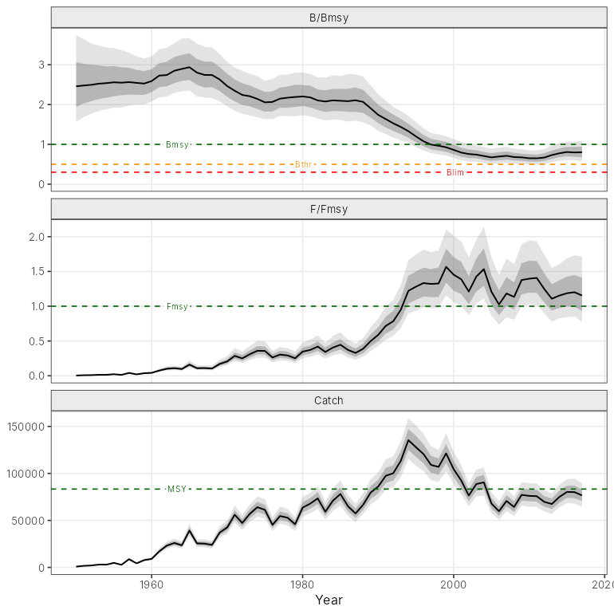 | 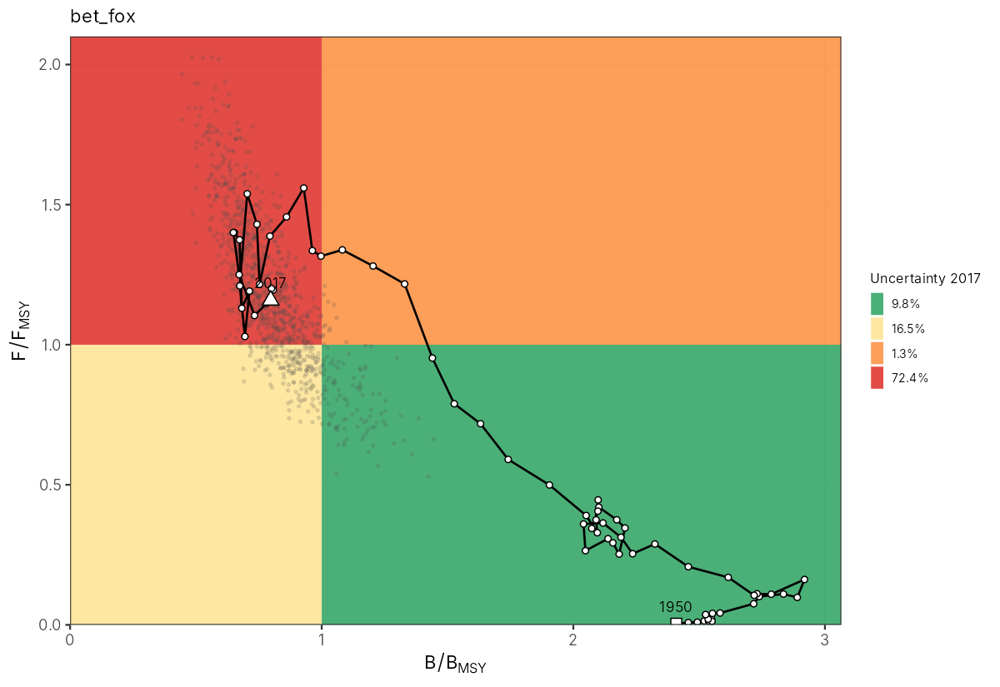 |
| 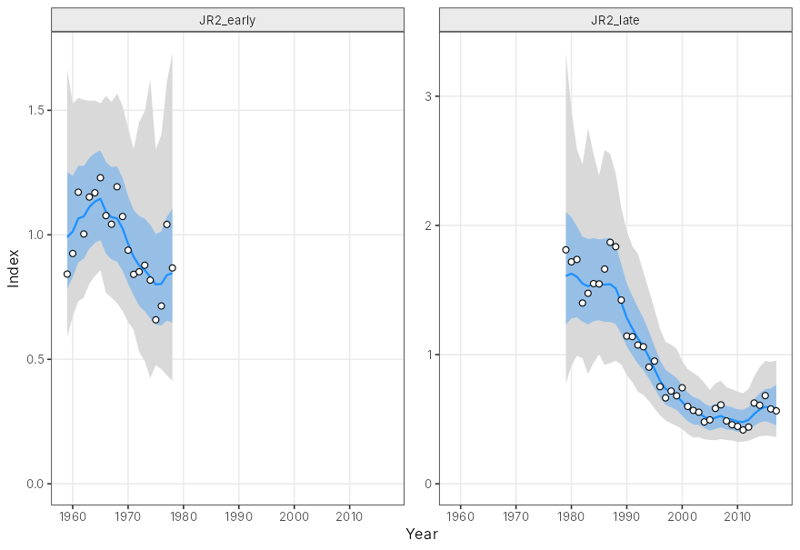 | 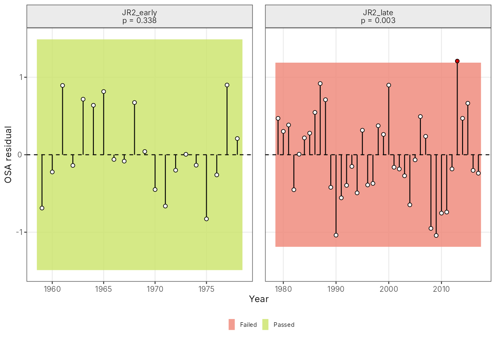 |
| 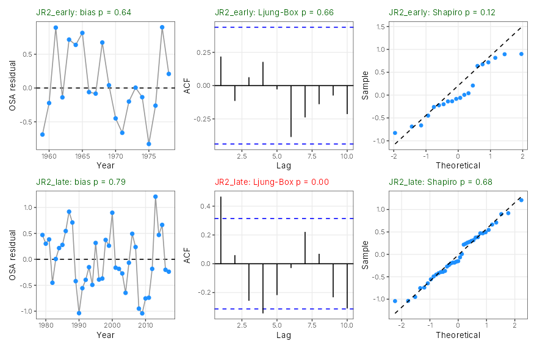 | 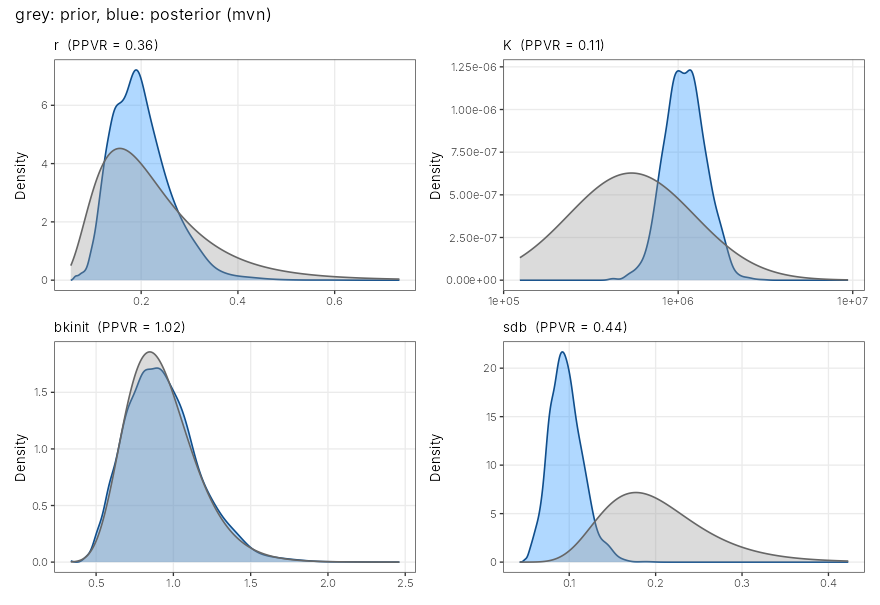 |
| 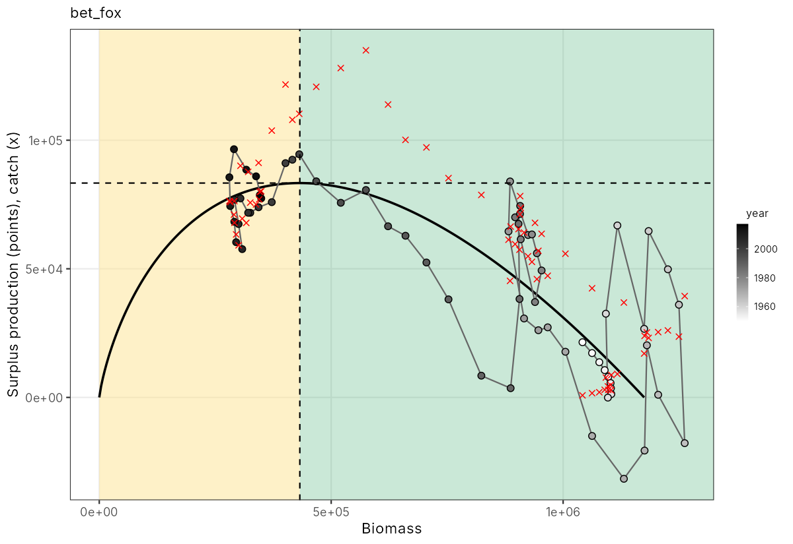 | 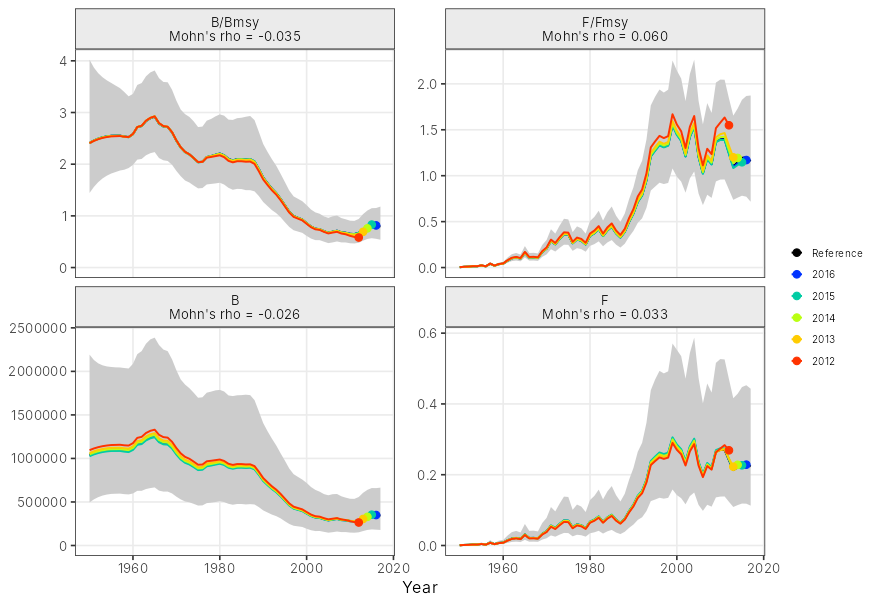 |
| 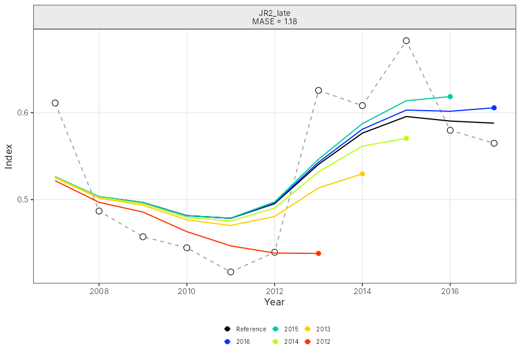 | 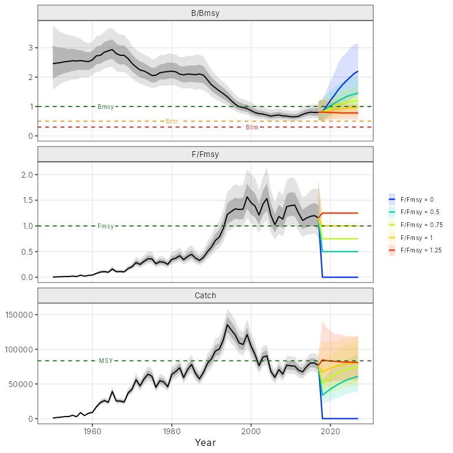 |
| 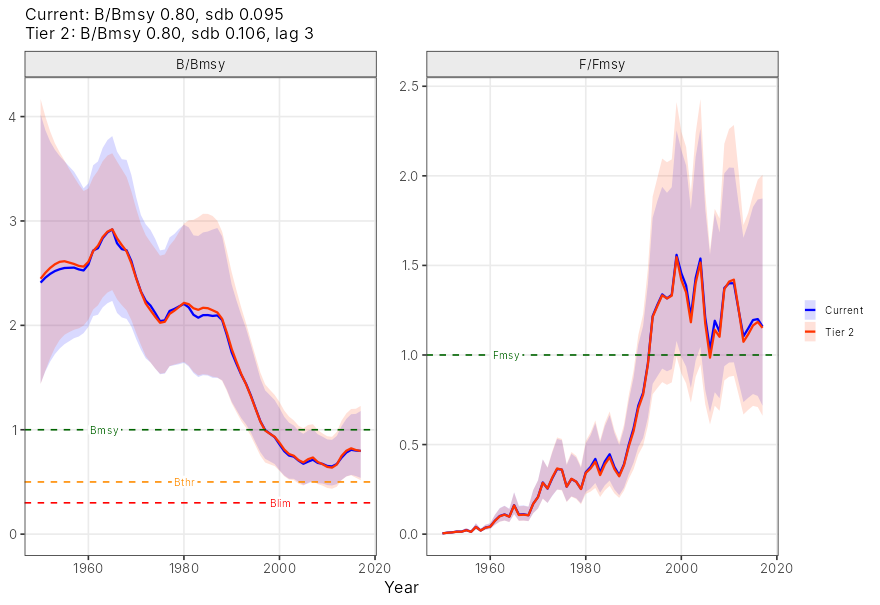 | 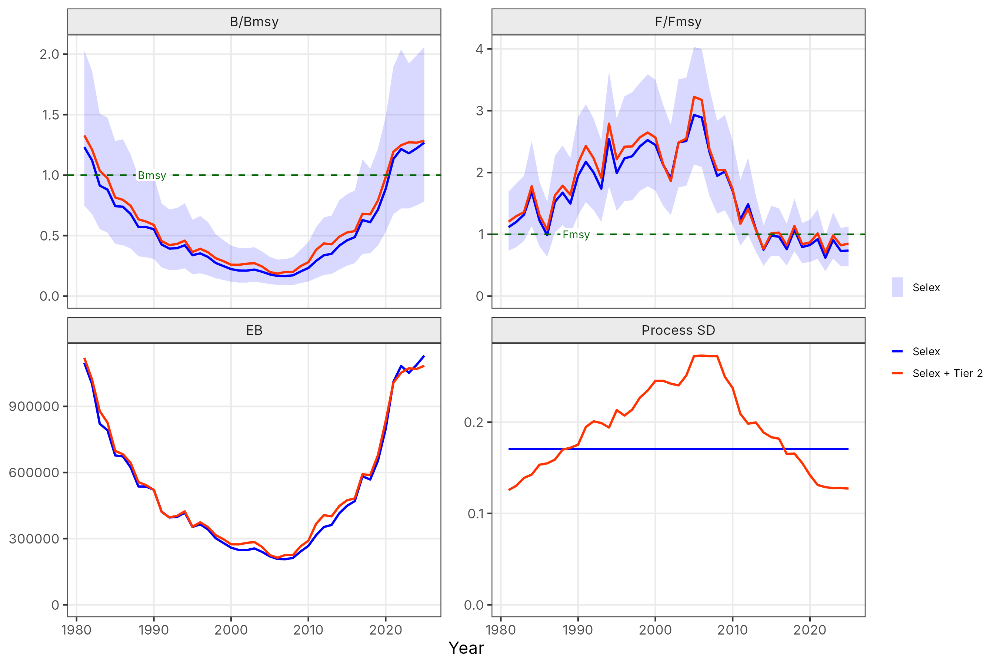 |
| 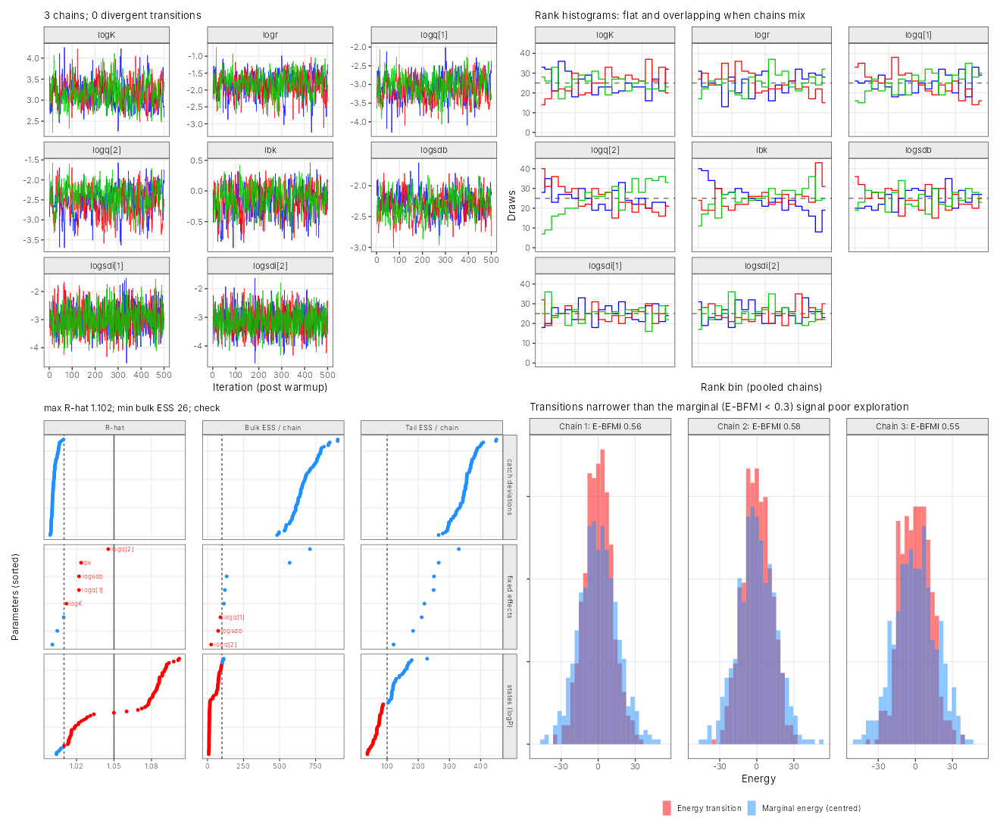 | |

## Validation against JABBA 2 (RTMB engine, same priors)

| Case (bigeye unless noted) | K | r | B/Bmsy 2017 | max abs diff, log B/Bmsy |
|---|---|---|---|---|
| Fox, FishLife sdb prior | 1174749 / 1174749 | 0.1929 / 0.1929 | 0.7973 / 0.7973 | 2e-5 |
| Pella 0.4 + lag 3 | 1335214 / 1335214 | 0.1885 / 0.1885 | 0.6949 / 0.6948 | 5e-5 |
| dynamic sdb 0.1 x (B/Bmsy)^-0.3, lag 3 | 1343508 / 1343513 | 0.1867 / 0.1867 | 0.7362 / 0.7361 | 5e-5 |
| Selex + lag 7 (Icelandic cod OM, iteration 1) | 1754481 / 1754201 | 0.2971 / 0.2972 | 1.3043 / 1.3042 | 9e-4 |

JAGS (JABBA 2.3, posterior median) against JABBA3 mode for the Fox case: K 1160830 / 1153334, r 0.197 / 0.196, B/Bmsy 0.773 / 0.792
(the remaining difference is mostly the uniform prior on q in JAGS against flat log q in JABBA3).

## Lineage

| Version | Engine | Notes |
|---|---|---|
| JABBA 1.x | JAGS | Winker et al. (2018) |
| JABBA 2.x | JAGS (RTMB engine as an extension) | process-error options, JABBA-Select |
| **JABBA3** | RTMB + NUTS | FLR interface, ggplot2 graphics (from JAGG) |
